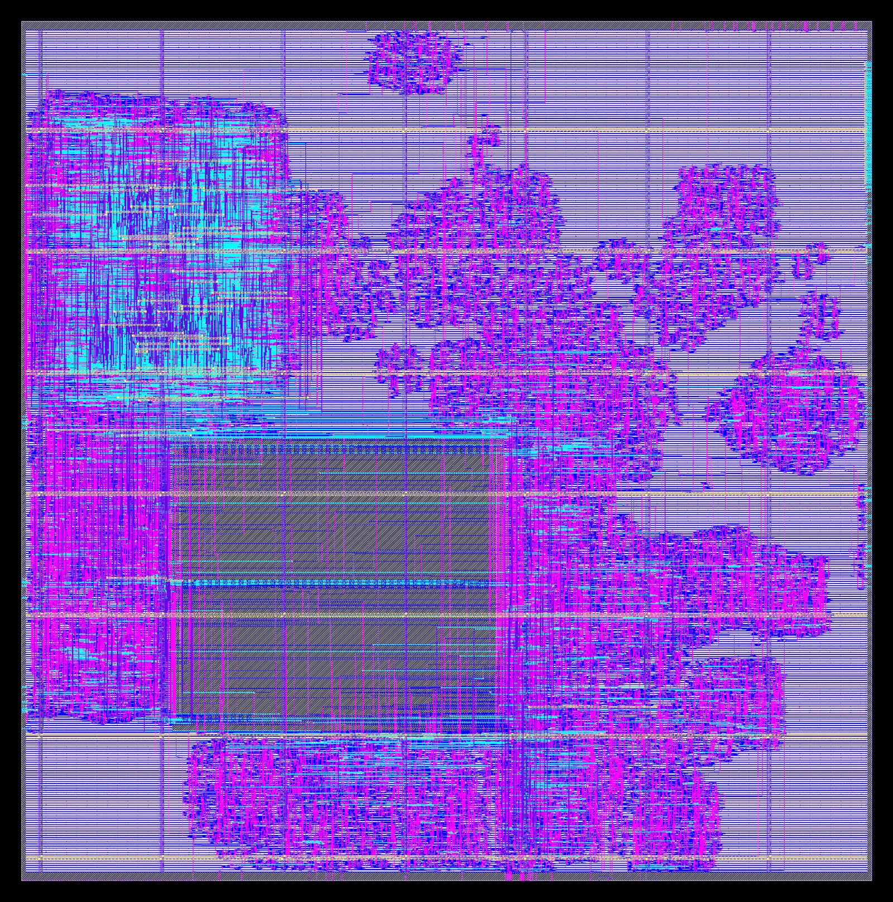
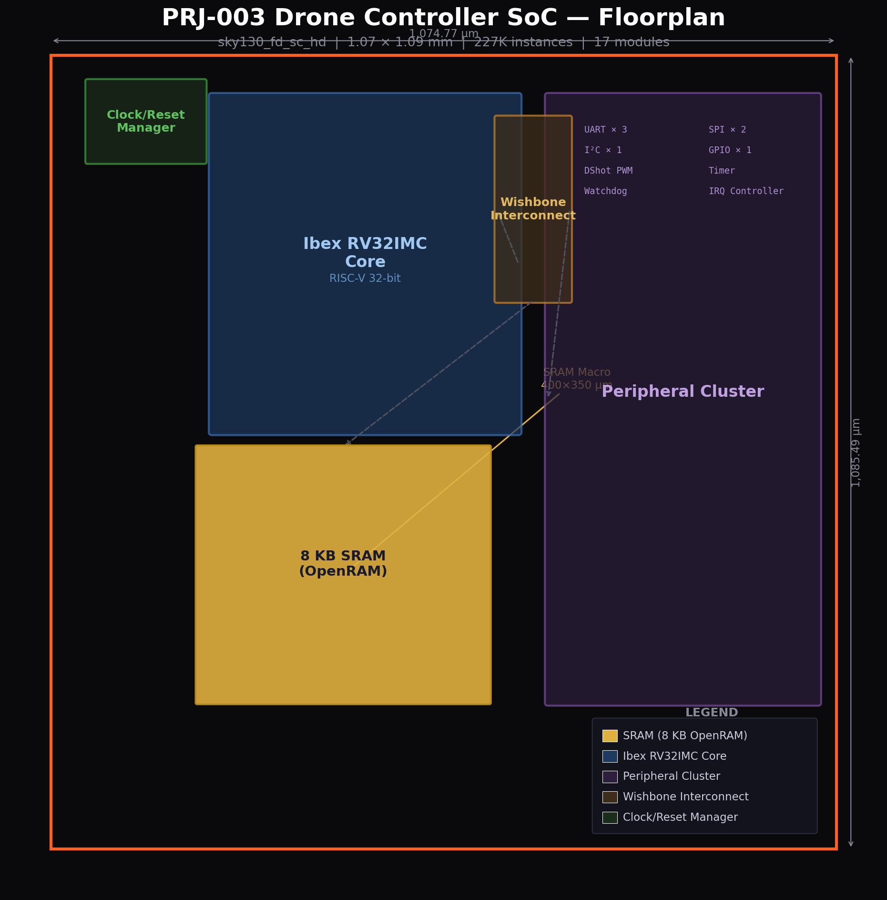
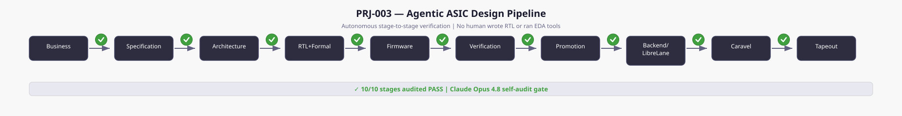

# PRJ-003 — Drone Controller SoC

**I designed the agentic ASIC framework. The framework autonomously produced this layout — no human wrote RTL, testbenches, or ran EDA tools.**

> **Status: not tapeout-ready.** The flow produced a routed GDS on SkyWater 130 nm, clean on DRC and LVS. But the SRAM in that GDS is a placeholder, the CPU does not implement the instruction set in the spec, and the tests check very little. This page was corrected on 2026-11-07 against the evidence in this repository. See [Known gaps](#known-gaps).





---

## Chip Summary

| Metric | Value |
|--------|-------|
| **Core** | Custom five-stage RV32I pipeline, in a module named `ibex_core`. It is not lowRISC Ibex, and it has no M, C or CSR instructions |
| **Process** | sky130_fd_sc_hd (SkyWater 130nm) |
| **Frequency** | 16.67 MHz (60 ns period), closed with +30.02 ns setup slack. The project owner relaxed the first target of 50 MHz after v2 |
| **SRAM** | 8 KB in the spec. The layout holds a 400 × 350 µm placeholder macro with no memory cells |
| **Modules** | 17 (3× UART, 2× SPI, I2C, GPIO, DShot PWM, Timer, Watchdog, IRQ Ctrl, Clock/Reset Mgr, Wishbone Interconnect, CPU core, SRAM, Caravel Wrapper) |
| **Cells** | 68,269 placed cells, including 5,042 flops and 12,978 combinational cells. 227,644 instances with fill |
| **Die** | 1,074.8 × 1,085.5 µm (1.17 mm²), for the Caravel user area |
| **Power** | 1.8V core / 3.3V IO |
| **Flow** | LibreLane v3 (Yosys + OpenROAD + Magic + Klayout) |

---

## Stage Status

Every stage was dispatched and executed by agents. The chain blocked four times and needed a person to restart it (see `11_postmortem_audit/11_final_postmortem.md`).

These are the verdicts the flow gave itself. [Known gaps](#known-gaps) lists what they missed or waived.

| # | Stage | Verdict | Retries |
|---|-------|---------|---------|
| 0 | Business Analysis | PASS | 1 |
| 1 | Specification | PASS | 0 |
| 2 | Architecture | PASS | 0 |
| 3 | Frontend (RTL) | PASS under waivers: the gate script exited 1 with 38 of 90 checks failing | 2 |
| 4 | Firmware | PASS: builds, but bring-up on RTL is blocked | 0 |
| 5 | Verification | PASS: no gate-level simulation | 0 |
| 6 | Promotion | PASS | 0 |
| 7 | Backend (P&R) | PASS 20/21 | 1 |
| 8 | Caravel Integration | PASS | 0 |
| 9 | Documentation | PASS | 0 |

---

## Key Results

### Backend (Physical Design)
- **Setup WNS:** +30.02 ns at 16.67 MHz (60 ns period), worst corner `max_ss_100C_1v60`
- **Hold WNS:** +0.09 ns
- **DRC:** 0 violations (Magic + Klayout), on a layout with a placeholder SRAM
- **LVS:** 0 errors, with the SRAM as a black box
- **Antenna:** 1 net waived
- **Max slew / cap / fanout:** 19,447 / 128 / 2,387 violations, not fixed
- **GDS:** Produced in 3 formats (Magic, Klayout, final)

### Verification
- **Testbenches:** 18 cocotb modules, 368 tests, all passing
- **What they check:** of 491 asserts, 104 are `assert True` and the other 387 check only a bus or reset ack. None compares read data or a pin value. They show that the simulation runs and the bus responds, not that a block works
- **Coverage:** the Tier A, B and C labels come from synthesis cell counts. Coverage was not measured
- **Formal:** all 16 SymbiYosys runs report `tests=0`, because the RTL has no assertions, so nothing was proved
- **Equivalence:** 6 of 16 logs pass, 10 fail on wrapper naming and are waived, 2 modules were not attempted
- **Gate-level simulation:** not run
- **Firmware:** compiles for `rv32imc_zicsr`, which this core cannot execute. Bring-up on RTL is blocked

### Caravel Integration
- **mpw-precheck:** the report lists 15 of 15 after 3 runs. The waiver ledger records waivers on the port and power-connection checks (W09-001, W09-002)
- **BEOL check:** passed

---

## Known Gaps

1. **The SRAM is a placeholder.** `08_backend_stage/librelane/config.yaml` calls it a dummy. `08_backend_stage/macros/sram_8kb/sram_8kb.gds` is 15 KB: 175 rectangles and no cell references, with no power pins in its LEF. Four real 2 KB OpenRAM macros (683.1 × 416.54 µm each) would take 1.14 mm², nearly this whole die, so the floorplan and timing would change.
2. **The CPU is not Ibex and is not RV32IMC.** `04_frontend_stage/rtl-ibex_core/rtl/` holds 15 small Verilog files with a five-stage pipeline. They decode RV32I opcodes only. The architecture document describes a two-stage Ibex with multiply and divide, which the RTL does not match.
3. **The tests cannot find most bugs.** See Verification above. "No RTL bugs found" could not have been concluded from them.
4. **Formal and gate-level checks did not happen.** Frontend waivers named gate-level simulation as their compensation, and it never ran. `11_postmortem_audit/POSTMORTEM_IMPROVEMENT_PLAN.md` records this circular waiver.
5. **All waivers are open.** `waiver_ledger.json` has 22 entries, none resolved, and none with evidence found for its compensating check.

---

## Repository Structure

The early-stage directories (business, specification, architecture) include only the primary output document — the full stage artifacts are extensive and were used to inform downstream stages, but the single document captures the essential technical content.

```
├── README.md
├── layout.png                  ← KLayout GDS render
├── .gitignore
├── waiver_ledger.json
├── 00_validation_report/       ← per-stage validation (11 reports)
├── 11_postmortem_audit/        ← postmortems + improvement plans (9 reports)
├── 01_business_stage/          ← market analysis
├── 02_specification_stage/     ← system specification
├── 03_architecture_stage/      ← architecture document
├── 04_frontend_stage/          ← RTL + lint/synth/formal/equiv logs
├── 05_firmware_stage/          ← BSP + drivers + bootrom
├── 06_verification_stage/      ← cocotb testbenches + results
├── 07_promote_stage/           ← per-module promotion reports
├── 08_backend_stage/           ← GDS + constraints + macros
├── 09_caravel_stage/           ← mpw-precheck logs + report
└── 10_document_stage/          ← documentation
```

> **Note on language stats:** Some Yosys intermediate files (`.il`, `.smt2`) from formal verification are excluded via `.gitignore`. These are tool byproducts, not hand-written code. Any remaining non-Verilog files in the formal directories are solver artifacts generated during BMC/k-induction proofs.

---

## Design Flow



The "10/10 stages audited PASS" and "Tapeout" labels in this diagram describe the flow as it reported itself, not the state of this layout.

**Framework:** Hermes agentic ASIC workflow — Vera orchestration.

---

## Third-Party Components

This project integrates and redistributes the following open-source hardware components. Each retains its original license.

| Component | Source | License |
|-----------|--------|---------|
| Caravel Harness | Efabless | Apache 2.0 |
| sky130 PDK | SkyWater / Google | Apache 2.0 |
| EF_UART, EF_SPI, EF_GPIO8, EF_TMR32, EF_WDT32, EF_I2C | Efabless IP Library | Apache 2.0 |

The CPU core is original to this project, not lowRISC Ibex. No OpenRAM macro is in the layout.

See [THIRD_PARTY.md](THIRD_PARTY.md) for full attribution and license text references.

---

## License

This project's original content (the agentic framework output, orchestration, and integration work) is licensed under Apache 2.0. Third-party components retain their original licenses as listed above. See [LICENSE](LICENSE).

---

*Generated by the Hermes ASIC workflow — July 19, 2026. README corrected November 7, 2026.*
*No human wrote RTL, testbenches, constraints, or ran EDA tools for this layout.*
*The framework iterated its work internally across 10 stages. This repository holds the output, not a development log.*
